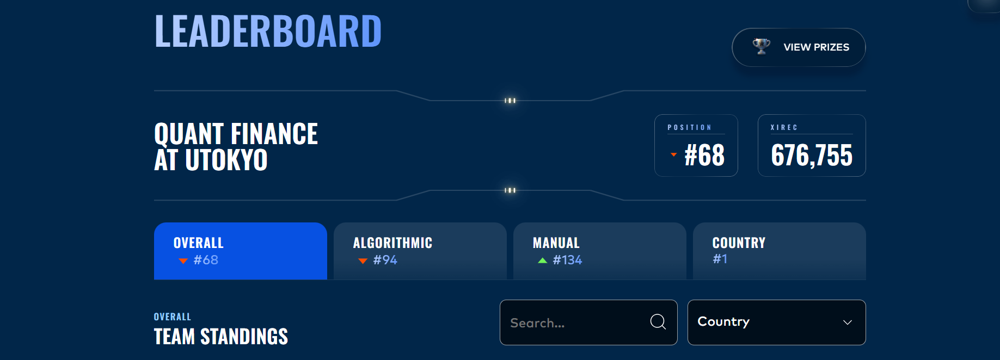
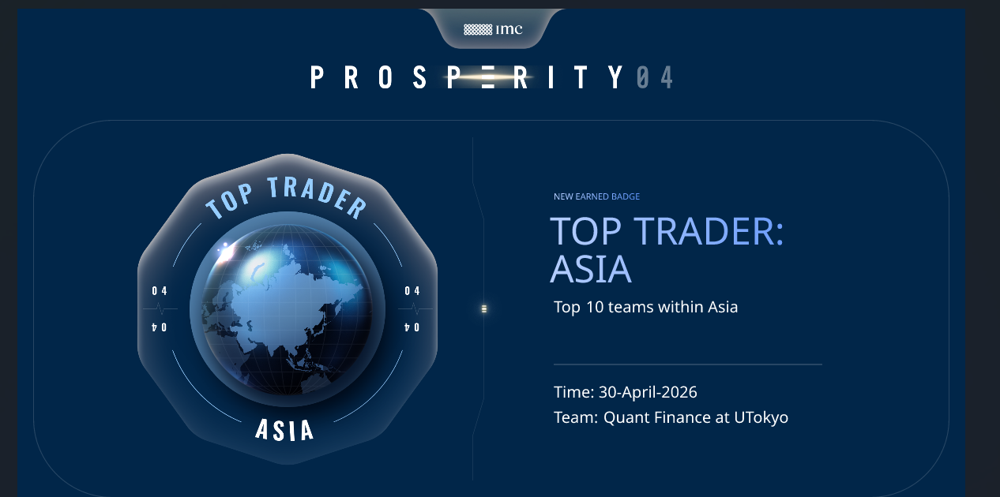
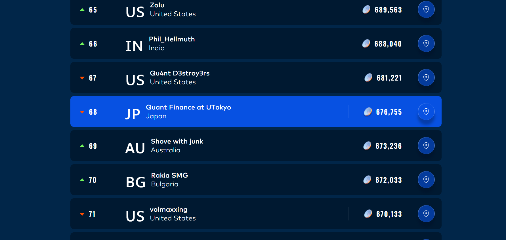

# IMC Prosperity 4

Algorithms and manual-round analysis for **IMC Prosperity 4** (April 2026), team **Quant Finance at UTokyo**.

We took part as a team. I wrote the algorithmic traders for all rounds (`round0/` to `round5/`); the manual rounds were team work.

## Result

**68th globally, 8th in Asia, 1st in Japan**, with 676,755 XIRECs in total.

| Ranking | Position |
|---|---:|
| Overall | 68 |
| Algorithmic | 94 |
| Manual | 134 |
| Asia | 8 |
| Japan | 1 |





<details>
<summary>Leaderboard around our position</summary>



</details>

## What is IMC Prosperity?

Prosperity is an annual trading competition for students run by [IMC Trading](https://www.imc.com). Teams trade fictional products on a simulated exchange, scored in the in-game currency XIRECs, over a tutorial and five rounds. Each round has two parts:

- **Algorithmic trading.** You submit a Python file with a `Trader` class. Every tick, the exchange calls `Trader.run(state)` with the order book, your position, recent trades and other observations, and you return a list of orders. Orders trade against bots in the simulation, and each product has a hard position limit: if your orders could push the position past it, they are all rejected. New products arrive each round, and each one usually hides a specific pattern to exploit: a stable fair value, a trend, an option chain, an informed trader.
- **Manual trading.** A one-off puzzle, usually game theory or pricing, answered by hand in the web interface.

The `Trader` object is not guaranteed to survive between ticks, so anything the algorithm needs to remember (rolling averages, past prices) has to be serialized into the `traderData` string, which the exchange hands back on the next tick.

## Repository

```
round0/  tutorial      EMERALDS, TOMATOES
round1/  round 1       ASH_COATED_OSMIUM, INTARIAN_PEPPER_ROOT
round2/  round 2       same products + a bid for extra market access
round3/  round 3       HYDROGEL_PACK, VELVETFRUIT_EXTRACT, 10 VEV vouchers (call options)
round4/  round 4       same as round 3 + counterparty IDs on trades
round5/  round 5       50 products in 10 categories, position limit 10 each
manual/              manual-round analysis (rounds 2–4)
examples/            a 50-line market maker to start from
```

Each `roundN/trader.py` is a single file that can be uploaded as-is, picked from about 10–30 versions per round. I did not keep a record of exactly which file was our final submission. For rounds 1–3 these are my last versions of the round, and for rounds 4 and 5 the versions closest to the code in our upload logs from the competition site. The tutorial file is the uploaded code itself.

## Strategies

### Tutorial: EMERALDS and TOMATOES
- **EMERALDS** sit at a fixed fair value of 10,000. Buy below it, sell above it, and quote one tick inside the best bid and ask.
- **TOMATOES** drift. Fair value is the *wall mid*: the midpoint of the deepest bid and ask levels. Bots that quote large size there are less noisy than the best bid and ask.

### Round 1: market making and buy-and-hold
- **ASH_COATED_OSMIUM** mean-reverts around 10,000. Wall-mid market making: take anything priced through fair value, then quote just inside the book.
- **INTARIAN_PEPPER_ROOT** trended steadily upward in the data. The best trade was to buy up to the position limit early and hold.

### Round 2: refining the market maker
Same products. The ACO fair value blends the wall mid, a volume-weighted mid and the 10,000 anchor, and is skewed against inventory (a long position lowers fair value, so we sell sooner). How far through fair we are willing to take depends on how wide the spread is. Pepper root no longer lifts asks above the best bid; it bids one tick above it instead. `Trader.bid()` returns our bid for the round's market access fee.

### Round 3: options on VELVETFRUIT_EXTRACT
- **HYDROGEL_PACK**: the round-2 market maker, anchored at 10,000.
- **VELVETFRUIT_EXTRACT** and the deep in-the-money vouchers (strikes 4000–5100): market making around an anchored fair value.
- **VEV_5200 and VEV_5300** (near the money) take a directional position that follows the underlying's deviation from its rolling anchor: short when the underlying is rich, long when cheap, scaled by its volatility, with a guard against fast crashes.
- On top of that, a **call-curve residual signal**: fit a monotone, convex call price curve across all strikes each tick (isotonic regression, then a convexity projection), take each voucher's residual from the curve, and lean the position against large z-scores of that residual.

### Round 4: trading against informed and uninformed counterparties
Trades now show who traded. Measuring the price move after each counterparty's trades showed that one bot, Mark 49, consistently traded at bad prices: after it sold, the mid rose by about 1.8 on average, and after it bought, the mid fell by about as much. Mark 22 showed the same pattern, but much more weakly. The strategy keeps round 3's market making and loosens the take thresholds whenever their quotes are in the book, so we trade with them more aggressively.

### Round 5: 50 products, limit 10
With a position limit of only 10 per product, the round is about choosing direction:
- a fixed **long/short view** on 8 products, chosen from analysis of the historical days
- **relative value** within baskets of related products (e.g. SNACKPACK chocolate vs. vanilla, PEBBLES XL vs. L/M/S)
- **wall-mid market making** with a fast/slow EMA trend filter for everything else

`round5/trader.py` is generated by concatenating modules (constants, datamodel stub, logger, strategy) into one uploadable file.

## Backtests

Backtested with [prosperity4btest](https://github.com/nabayansaha/imc-prosperity-4-backtester) on the historical data released for each round. Profits are in XIRECs; they are in-sample (the strategies were tuned on this data), so they overstate live results.

| Round | Days | Profit per day | Total |
|---|---|---|---:|
| Tutorial | −2, −1 | 17,443 · 13,950 | 31,393 |
| 1 | −2, −1, 0, 1 | 96,358 · 97,151 · 96,628 · 7,659 | 297,796 |
| 2 | −1, 0, 1 | 95,046 · 96,111 · 95,627 | 286,784 |
| 3 | 0, 1, 2 | 230,904 · 209,418 · 186,589 | 626,912 |
| 4 | 1, 2, 3 | 236,273 · 219,445 · 297,807 | 753,525 |
| 5 | 2, 3, 4 | 254,908 · 242,994 · 244,234 | 742,137 |

The [simple example](examples/simple_market_maker.py) only market-makes ASH_COATED_OSMIUM around 10,000. It makes about 14,000–17,000 per day in round 1, against about 96,000 per day for the round 1 trader, most of whose extra profit comes from holding pepper root.

## Manual rounds

Analysis scripts from the team's work on the manual rounds:

| Round | Puzzle | Approach |
|---|---|---|
| 2 | *Invest & Expand*: split a 50,000 budget across Research, Scale and Speed, where Speed pays according to your rank among all players | [Closed-form optimum](manual/round2/invest_expand.py) for given Speed, then a [symmetric Nash equilibrium](manual/round2/nash.py) over other players' choices |
| 3 | Two sealed bids against counterparties with reserve prices between 670 and 920, with a penalty if the second bid is below the average | [Expected value simulation and best-response iteration](manual/round3/bid_simulation.py) |
| 4 | A portfolio of exotic options on one underlying (vanilla, binary, chooser, knock-out) | [Pricing](manual/round4/analytic_pricer.py), [path simulation](manual/round4/path_simulation.py) and a [portfolio optimizer](manual/round4/analytic_optimizer_v3.py) trading off mean against standard deviation, solved as a MISOCP ([report](manual/round4/analytic_optimizer_v3_report.md)) |

## Run

```bash
pip install -r requirements.txt
python -m prosperity4bt round0/trader.py 0                       # tutorial data is bundled
python -m prosperity4bt round1/trader.py 1 --data <data dir>     # other rounds need their data
pytest                                                           # position-limit tests
```

The data is not included in this repository. The backtester only knows the position limits of the round 0–2 products and uses 50 for anything else, so rounds 3–4 need the real limits:

```bash
python -m prosperity4bt round3/trader.py 3 --data <data dir> \
  --limit HYDROGEL_PACK:200 --limit VELVETFRUIT_EXTRACT:200 \
  --limit VEV_4000:300 --limit VEV_4500:300 ...   # 300 for every VEV voucher
```

## Credits

- The wall-mid idea follows the published Prosperity 3 code of Frankfurt Hedgehogs, one of that year's top teams.
- The `Logger` class is the standard one for jmerle's Prosperity visualizer.
- Backtests use Nabayan Saha's [prosperity4btest](https://github.com/nabayansaha/imc-prosperity-4-backtester).
